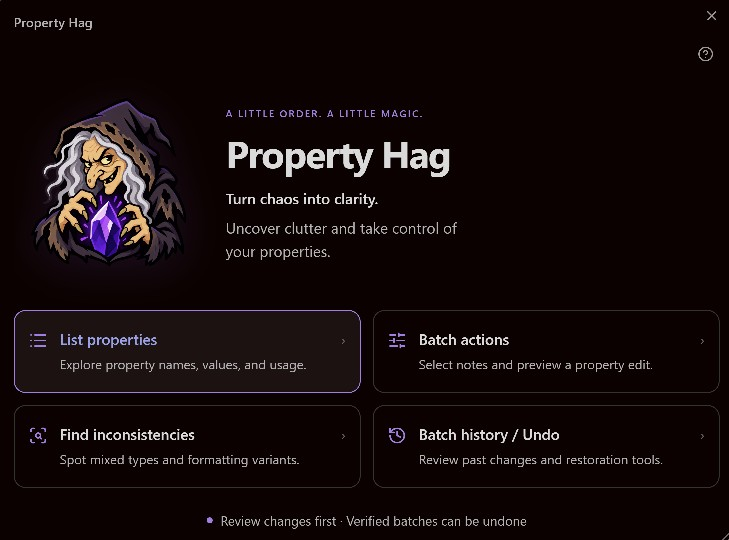
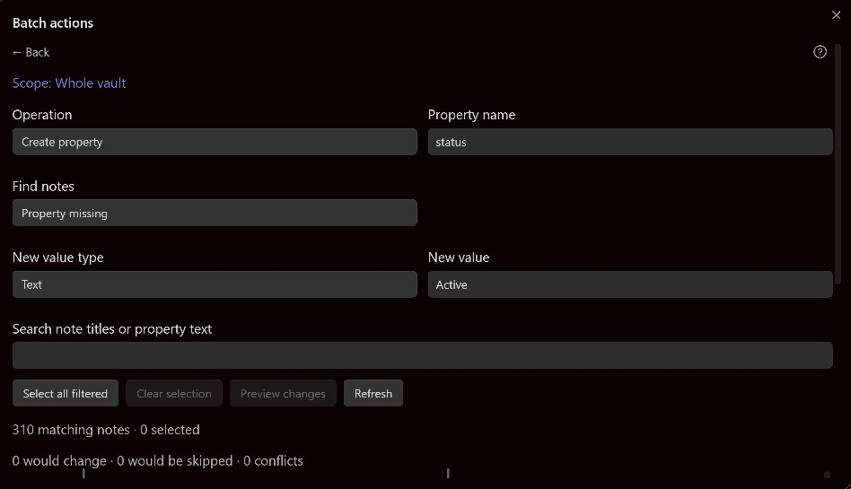

# Property Hag

Turn chaos into clarity. Property Hag helps you clean up the details that keep your Obsidian notes organized—things like status, category, dates, and lists. See what you already use, spot inconsistencies, and update selected notes together instead of fixing them one by one.

Stay in control of every change. Choose the notes, review what will happen, and confirm when you're ready. Saved batch history lets you review the results and undo eligible changes later.

## Features

- **Bulk property editing** — add, update, rename, and remove
- **Vault-wide property browsing and usage counts**
- **List-item editing and empty-property cleanup**
- **Advanced search and flexible filters**
- **Existing property and value suggestions**
- **Typo, formatting, and consistency checks**
- **Before-and-after previews**
- **Automatic backups, verified saves, and batch Undo**
- **Desktop and mobile support**

## Installation

Requires **Obsidian 1.5.7 or newer**. Supports desktop and mobile.

1. Download **main.js**, **manifest.json**, and **styles.css** from the plugin release.
2. Create a **property-hag** folder inside your vault’s **.obsidian/plugins** folder.
3. Place the three files inside it:

   ~~~text
   main.js
   manifest.json
   styles.css
   ~~~

4. Restart Obsidian, then enable **Property Hag** under **Settings → Community plugins**.

The logo and help are included in main.js; separate asset and help folders are not required to run the plugin.

### Updating

Replace the three release files in your existing plugin folder and restart Obsidian. Keep **data.json**, **history-backup.json**, and **backups/** together to retain saved history and Undo.

## Getting started

Click the Property Hag ribbon icon or run **Property Hag: Open property browser** from the command palette.

Choose **List properties** to explore your vault. This screen lists unique property names, not individual notes. Select a property to see the notes using it, then choose **Batch actions for this property** to start an edit.

To work within a folder, open that folder’s context menu and choose **Batch Edit Properties**. You can include or exclude its subfolders.

## Making a batch change

1. Check **Scope** to confirm where you’re working.
2. Choose an **Operation** and **Property name**.
3. Use **Find notes** and search to narrow the list.
4. Choose an existing value or enter a new one when needed.
5. Check the notes you want to change and choose **Preview changes**.
6. Review the Before/After values and warnings, then choose **Apply changes…** and confirm.

**Create property** adds a property only where it is missing. **Set property value** updates only notes that already have it. Removing a property never removes the note.

Unchecked notes are outside the batch. The skipped count refers to selected notes that require no change. Changing filters clears selections that no longer match; newly matching notes are not selected automatically.

## Searching

Searches ignore capitalization and match parts of words. Search fields use the information shown on their screen, rather than searching every note’s full contents.

| Search | Finds |
| --- | --- |
| toastmasters; tm or toastmasters OR tm | Either term |
| toastmasters AND speech or toastmasters speech | Both terms, in any order |
| toastmasters -archived or toastmasters NOT archived | Toastmasters matches without archived |
| "public speaking" | That exact phrase, with the words together |

Exclusions apply first, then AND, then OR. To exclude a term from both alternatives, repeat it: **toastmasters NOT archived OR tm NOT archived**. Operators also accept lowercase. Put literal operator words or semicolons inside quotes, such as **"AND"** or **"a;b"**.

An invalid or unfinished search shows an error and matches nothing. Property/value suggestions and the **Match value** filter use literal values rather than these search operators.

## History and Undo

Open **Batch history / Undo**, choose a saved batch, review its Undo preview, then confirm **Undo ready notes**.

Only saved and verified changes are eligible. Later edits to an affected property, unsaved notes, or missing/moved notes can prevent Undo. Unrelated changes are preserved. Use **Original backup** to inspect the saved original without restoring it.

Undo restores property values; the affected entries’ spacing or placement may differ from the original. Review the results after applying or undoing a batch.

## Desktop and mobile controls

On desktop, drag a window’s title to move it, drag its bottom-right corner to resize it, and drag table dividers to adjust column widths. Click headings to sort.

On mobile, windows fit the screen and adjust for the keyboard and rotation. Forms stack vertically, controls are larger, and tables retain compact rows and columns, with horizontal scrolling when needed. Tap headings to sort; tablets retain scrollable tables.

Mobile layouts and Apply/Undo flows have automated coverage. Physical Android and iPhone validation is still pending.

Click or tap **?** in any tool window for help. Use **Back** to return to the previous screen.

## File safety and limitations

Keep a separate vault backup and try a small batch first. Previews do not save changes. Apply and Undo require confirmation, back up notes before writing, and verify the saved results.

Only affected property entries are edited. Surrounding properties, comments, and note text are preserved; the changed entry’s own formatting may be adjusted. Complex or unsupported layouts are reported as conflicts when they cannot be edited safely.

Dates use text inputs. Possible spelling mistakes and other inconsistency findings are suggestions for your review, not automatic corrections.

## Privacy and storage

Property Hag makes no network requests. History and backups are stored locally in its plugin folder.

**Backups contain full note content.** Keep **data.json**, **history-backup.json**, and **backups/** private and together if you want to retain Undo. Do not include them when sharing or publishing the plugin. Release files contain no saved vault history or backups.

## Version

Current version: **1.0.1**. See [CHANGELOG.md](CHANGELOG.md) for release notes.

## Author

Kempf

## License

MIT License. See [LICENSE](LICENSE). The bundled YAML library retains its separate ISC license in [assets/yaml-LICENSE.txt](assets/yaml-LICENSE.txt).
